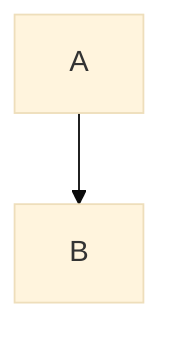
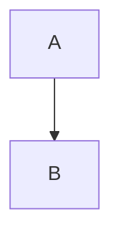
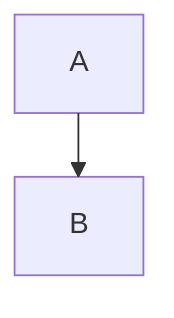
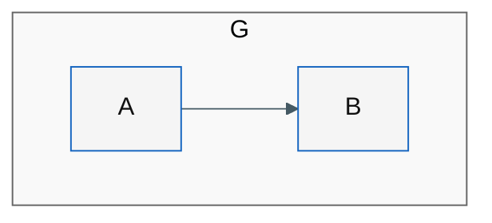

# Theming, interaction, and export

Only non-obvious facts.

## Frontmatter config

YAML frontmatter must be the very first thing in the fence, before the diagram keyword; a blank line or `%%` comment above `---` is a parse error. `themeVariables` is only fully honored with `theme: base`; the other themes ignore most variables.



The older `%%{init: {...}}%%` directive still works where frontmatter is unsupported.

## Themes, look and layout (Mermaid 12)

Mermaid 12.0.0 changed all three defaults: flowchart, state, class and ER diagrams now render with theme `redux-color`, look `neo` and layout `elk` (sequence diagrams change theme and look; other types keep `default` and `classic`). A diagram written for Mermaid 11 therefore re-lays out and recolours on a 12 renderer. To get the Mermaid 11 appearance back, set all three:



- Built-in themes: `redux-color`, `redux-dark-color`, `redux`, `redux-dark`, `default`, `neutral`, `dark`, `forest`, `neo`, `neo-dark`, `base`. `mmdc --help` lists the `-t` choices of the installed CLI (it also accepts `null`).
- Looks: `classic`, `handDrawn`, `neo`.
- Layouts: `elk`, `dagre`, `cose-bilkent`, `tidy-tree`. ELK ships inside `mermaid` from 12.0.0 and needs no registration there; a host older than 12, or the tiny build, falls back to dagre unless `@mermaid-js/layout-elk` is registered.
- ELK options go under `elk:` (`mergeEdges`, boolean, default false; `nodePlacementStrategy`, one of `SIMPLE`, `NETWORK_SIMPLEX`, `LINEAR_SEGMENTS`, `BRANDES_KOEPF`). The schema page lists the other eleven properties.



`themeVariables` works only on `theme: base`. Beyond the colors in authoring-rules.md section 6, the structure variables are `background` (default `#f4f4f4`), `mainBkg` (flowchart node, class and sequence element background), `nodeBorder` (default `primaryBorderColor`), `clusterBkg` (default `tertiaryColor`) and `clusterBorder` (default `tertiaryBorderColor`):



Sources, checked 2026-11-13: https://mermaid.js.org/config/theming.html (themes, looks, variables), https://mermaid.js.org/config/layouts.html (layouts, ELK bundled), https://mermaid.js.org/config/schema-docs/config-properties-elk.html (ELK options), and the `mermaid@12.0.0` notes at https://github.com/mermaid-js/mermaid/releases ("add layout: dagre, theme: default and look: classic to keep the old look"). The renderer's own list wins if it differs.

## Interaction

`click NODE "url" "tooltip"` works only when the host allows it: GitHub strips click handlers, and `mmdc` needs `securityLevel: loose` for JavaScript callbacks. Do not rely on click in docs.

## Export with mmdc

```bash
npx -y @mermaid-js/mermaid-cli -i README.md -o out.md   # renders each fence to an SVG and replaces it with an image link
```

Check the result at about 900px wide, the reading column, not only at full size. If the render fails with a Chromium sandbox error, see SKILL.md step 4.

Flags: `-e` picks `svg`, `png` or `pdf`; `-b` sets the background (`transparent` or a color, `-b "#ffffff"`); `--size` limits the width or height; `-s` is the scale factor; `-t` the theme. The old `-w` and `-H` size flags no longer exist (mmdc 12.2.0 exits 1 with `unknown option '-w'`), so use `--size`. `mmdc --help` prints the installed CLI's flags.

```bash
npx -y @mermaid-js/mermaid-cli -i diagram.mmd -o diagram.png --size 1200 -b transparent
```

Without Node, use the Docker image from the mermaid-cli README. Run it as your own user so the output is not owned by root (podman also needs `--userns keep-id`); the images are `minlag/mermaid-cli` and `ghcr.io/mermaid-js/mermaid-cli/mermaid-cli`:

```bash
docker run --rm -u `id -u`:`id -g` -v /path/to/diagrams:/data minlag/mermaid-cli -i diagram.mmd
```

Sources, checked 2026-11-13: https://github.com/mermaid-js/mermaid-cli (README, Use Docker/Podman, `--size`) and `mmdc --help` (12.2.0).

## Accessibility

Add `accTitle:` and `accDescr:` lines inside the diagram for screen readers (flowchart, sequence, class, state, ER).
