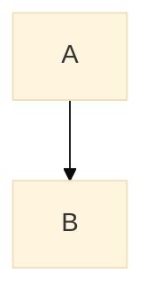

# Theming, interaction, and export

Only non-obvious facts.

## Frontmatter config

YAML frontmatter must be the very first thing in the fence, before the diagram keyword; a blank line or `%%` comment above `---` is a parse error. `themeVariables` is only fully honored with `theme: base`; the other themes ignore most variables.



The older `%%{init: {...}}%%` directive still works where frontmatter is unsupported.

## Interaction

`click NODE "url" "tooltip"` works only when the host allows it: GitHub strips click handlers, and `mmdc` needs `securityLevel: loose` for JavaScript callbacks. Do not rely on click in docs.

## Export with mmdc

```bash
npx -y @mermaid-js/mermaid-cli -i README.md -o out.md   # renders each fence to an SVG and replaces it with an image link
```

Check the result at about 900px wide, the reading column, not only at full size. If the render fails with a Chromium sandbox error, see SKILL.md step 4.

## Accessibility

Add `accTitle:` and `accDescr:` lines inside the diagram for screen readers (flowchart, sequence, class, state, ER).
