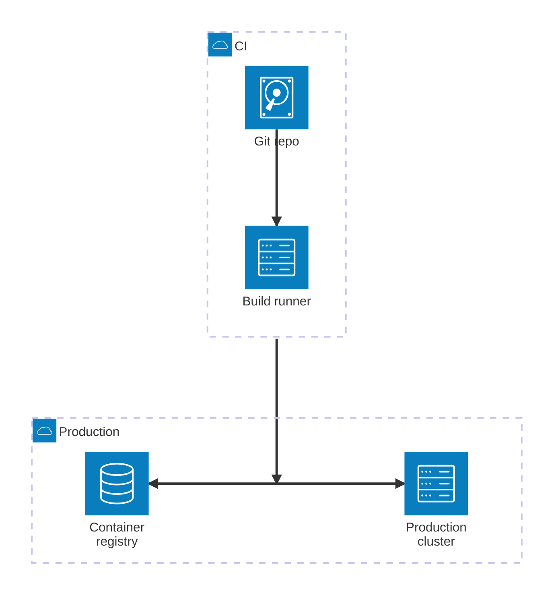

# architecture-beta

Version, icon, and edge-label limits are in SKILL.md ("Renderer and host constraints"). This file covers syntax only.

## Syntax

- `group id(icon)[Title] in parent?`, `service id(icon)[Title] in group?`, `junction id in group?`.
- Edge: `a:R --> L:b`. Each side letter (`T`, `B`, `L`, `R`) names where the line leaves or enters a box; `-->`, `<--`, `<-->`, `--` set arrowheads.
- `a{group}:B --> T:b` starts the edge at the boundary of `a`'s group instead of the service.

## Layout traps

- Edge sides are the only layout lever: `a:R --> L:b` places `b` to the right of `a`, `a:B --> T:b` places it below. Plan a top-down chain with `B --> T` edges (authoring-rules.md section 2, "Direction and proportion").
- A junction splits one edge into up to four branches without crossing lines.

## Custom icon packs

Only when the user names a renderer that registers the pack: Mermaid CLI takes it as `mmdc --iconPacks @iconify-json/logos ...`, a web page calls `mermaid.registerIconPacks`; then write `pack:icon-name` (`logos:docker`) and render in that host to confirm.

## Reference

- [Official Documentation](https://mermaid.js.org/syntax/architecture.html)
- [Iconify Icons](https://iconify.design)
