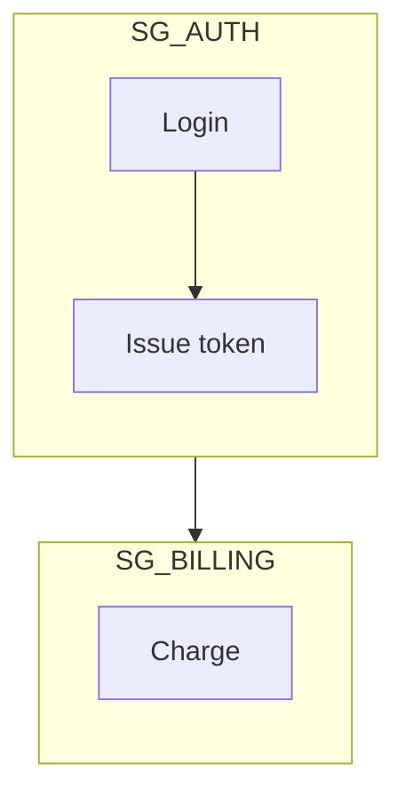
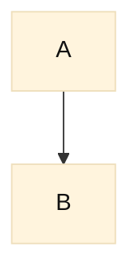

# Authoring rules

The single source for the rules to apply before writing any Mermaid block. A new diagram reads sections 1-3 and 6-7 (only 1 and 7 when the type is obvious and the diagram unstyled), plus sections 4-5 only for a flowchart (they replace a separate flowchart reference). A repair reads section 7, and a semantic repair of a flowchart also section 4. Other files cite sections by number and heading, so keep both stable. Syntax details live in the type references.

## 1. Choose the diagram type

Write one sentence: what question does this diagram answer? Pick the type that owns it. Two questions means two diagrams.

| Question the diagram answers | Draw | Request often wrongly drawn as a flowchart |
|---|---|---|
| Who calls whom, in what order? | `sequenceDiagram` | "flowchart of our API", login, call chain |
| What types exist and how do they relate? | `classDiagram` | domain model, "how the classes connect" |
| What tables, keys, and cardinalities? | `erDiagram` | schema, "how the tables link" |
| What software systems, containers, or components exist and who uses them? | C4 (`C4Container` by default) | "the architecture", system overview |
| Which infrastructure pieces (cloud services, runners, registries, clusters) connect? | `architecture-beta` | infra map, deployment topology |
| What states and legal transitions? | `stateDiagram-v2` | lifecycle, status workflow |
| How did branches diverge and merge? | `gitGraph` | branching strategy, hotfix flow |
| What runs when, and after what? | `gantt` | roadmap, sprint plan |
| What share of a whole? | `pie` | breakdown, split |
| What does someone or something walk step by step, with yes/no branches? | `flowchart` | none: use it only after every row above loses |

"Show the flow", "how does X work", and "flowchart of our API" are not evidence for a flowchart: an API call chain is a sequence. Honor an explicitly required diagram format (or ask before substituting), and use a flowchart for API routing, decisions or control flow when that is the question. "The architecture" is C4 unless the user asks for cloud or vendor icons or names `architecture-beta`.

## 2. Direction and proportion (every type)

- The reader is a Markdown column (GitHub, GitLab, docs) of about 900px; extra width is shrunk until the text is unreadable. Prefer top-down layouts; go left-to-right only for a row of three or four nodes. Never fix a cramped diagram by making it wider.
- For a flowchart with many components use `flowchart TD`; choosing `LR` or another layout needs a stated reason.
- Warning sign: a rendered height/width below 0.4. Split only when text becomes unreadable at the target column width (about 900px) or the diagram grows taller than about three screens; a short, wide diagram whose text stays readable is fine. One idea per diagram.
- You cannot place nodes. The levers are the ones in section 3 ("Type-native controls") plus declaration order: declare in reading order and keep the main path monotonic.

## 3. Type-native controls

Shapes by role, subgraphs, and `classDef` palettes (sections 4-6) are flowchart rules; never force them onto another type. Every other type uses only its own levers:

| Type | Layout levers | Styling and emphasis |
|---|---|---|
| `flowchart` | `TD`, subgraphs, per-subgraph `direction` | shapes by role, `classDef` palettes (sections 5-6) |
| `sequenceDiagram` | participant declaration order, `box` groups | `rect rgb(...)` around a span, `Note over` |
| `classDiagram` | `direction`, `namespace` | stereotypes (`<<interface>>`), `classDef` + `:::`, `style` |
| `erDiagram` | `direction` | `classDef` + `:::` on recent Mermaid; theme only on older hosts |
| C4 | `UpdateLayoutConfig($c4ShapeInRow, $c4BoundaryInRow)`, `Rel_U/D/L/R`, boundaries | `UpdateElementStyle`, `UpdateRelStyle` (label offsets) |
| `architecture-beta` | groups, edge sides `T/B/L/R`, junctions | built-in icons only; no per-service styling |
| `stateDiagram-v2` | `direction`, composite states | `classDef` + `class` (not on `[*]` or inside composite states) |
| `gantt` | sections | task tags `crit`, `active`, `done`, `milestone` |
| `gitGraph` | `gitGraph TB:`, branch creation order | `type: HIGHLIGHT`, `tag:`, theme variables `git0`-`git7` |
| `pie` | slice order | `showData`, theme variables `pie1`-`pie12` |

## 4. Subgraphs for grouping (flowchart only)

Default: group related nodes into a `subgraph` once there are about ten or more; fewer nodes may stay flat, and a larger diagram that reads clearly in one column may skip groups if you say why. Connect groups at the boundary: subgraph to subgraph, or subgraph to an outside node. If any node inside a subgraph links outside it, Mermaid ignores that subgraph's `direction` and inherits the parent's, with no error. Name groups and nodes so membership is obvious: `SG_AUTH` / `NODE_AUTH_login`.



Broken: `NODE_AUTH_token --> NODE_BILLING_charge` makes both subgraphs drop `direction TB`. If that edge is essential, delete the `direction` lines and accept the parent layout.

## 5. Shapes mean roles (flowchart only)

Default convention: one shape per role (step `[ ]`, decision `{ }`, store `[( )]`, start/end `([ ])`, sub-process `[[ ]]`). An established shape vocabulary of the user or the repo wins over it. Do not mix shapes for the same role or invent a shape per node; more than four shapes with no role system is noise.

Use a diamond for every real decision (a node whose outgoing edges are alternatives). A label on an ordinary step-to-step edge (`-->|retries 3x|`) is fine and needs no diamond. Draw stores as cylinders unless the house convention says otherwise.

Syntax trap: `A(Text)` is a rounded rectangle, `A([Text])` is the stadium.

## 6. Contrast and classDef palette

Every type:

- Host-themed diagrams (no custom colors) are fine whenever roles already read from shape and labels, or the audience's theme must win. Custom colors are a choice, not a requirement. When you set a fill, set its text color too (dark ink on light fills, light on dark). A transparent background must read on both a light and a dark page, or ask which one it sits on.
- Never let color be the only channel (color-blind readers, grayscale prints): pair it with a label, stereotype, or shape.

Flowchart palette (other types skip the rest of this section). Every `classDef` you write sets `fill`, `stroke`, and `color` together.

Default: give a flowchart of six or more nodes with distinct roles a palette, since all-default gray hides the roles. More than six distinct fills is garish: collapse to semantic classes. Color by role, not by node: `class NODE_AUTH_login,NODE_AUTH_token svc`. Accent the 10-20% of nodes that matter; leave the rest neutral. `linkStyle 0 ...` styles the first declared link, and the indexes shift whenever a link is added above it, so restyle after every edit.

`classDef` does not reach edge labels or unclassed nodes, so for a diagram embedded in Markdown also set the theme text colors to the same ink. This block is dark ink for a light page; on a dark page use light ink on dark fills:



The blocks below are the default. Any other palette (the user's, the repo's, a brand's, or one suited to the audience) is fine when every text/fill pair keeps a contrast of at least 4.5:1 and the roles still differ in grayscale; check that before using it, never guess. Contrast stays strict whenever custom colors appear. Palette A is the default. Pick another block only by what the colors mean: A for architecture or service maps, B when the diagram shows status, C for before/after. Mixing two palettes in one diagram is an error: the reader cannot tell which meaning a color carries.

A. Structure and services (architecture, service maps):

```
classDef edge   fill:#e3f2fd,stroke:#1565c0,color:#111111
classDef svc    fill:#ede7f6,stroke:#4527a0,color:#111111
classDef data   fill:#e8f5e9,stroke:#2e7d32,color:#111111
classDef extern fill:#eceff1,stroke:#455a64,color:#111111
```

B. Status. Put the status word in the label too. The saturated fills often seen (`#00b894`, `#fdcb6e`, `#ff6b6b`) pass with `#111111` text (about 7.5, 12.5, and 6.8:1) but fail with white text (about 2.5, 1.5, and 2.8:1); either set works with `#111111` text, never with white. This lighter set is the default:

```
classDef base    fill:#f5f5f5,stroke:#616161,color:#111111
classDef success fill:#e8f5e9,stroke:#2e7d32,color:#111111
classDef warning fill:#fff8e1,stroke:#b26a00,color:#111111
classDef error   fill:#fdecea,stroke:#c62828,color:#111111
```

C. Old versus new (migration, before/after):

```
classDef old fill:#eceff1,stroke:#607d8b,color:#111111
classDef new fill:#e8f5e9,stroke:#2e7d32,color:#111111
```

## 7. Labels that break the parser

- **Unquoted delimiters in labels** - `[ ] ( ) { } < > |` delimit shapes and edge labels, so `A[Deploy (prod)]` opens a second shape and fails (`got 'PS'`). Quote the whole label: `A["Deploy (prod)"]`. Quote any label with `#` too.
- **`#` and `;` in sequence text** - `#` silently drops the rest of a message and `;` ends the statement with a parse error. Write the entity codes `#35;` and `#59;`; HTML entities such as `&quot;` are not Mermaid syntax.
- **Line breaks** - `<br/>` breaks a label on every renderer; `\n` works only on recent Mermaid and prints literally on older hosts, so replace `\n` with `<br/>` in any repair.
- **Lowercase `end`** - as a flowchart node id or a sequence participant it closes a block and fails. Write `End` or rename the node; `end` inside quoted label text is fine.
- **`o` or `x` right after a link** - `A---oB` draws a circle-ended edge to `B`, and `A---xB` a cross. That is valid when the circle or cross end is intended; when the target node's name starts with `o` or `x` (for example `orders`), put a space before it or rename it. Keep intended circle and cross edges in every repair or styling edit.
