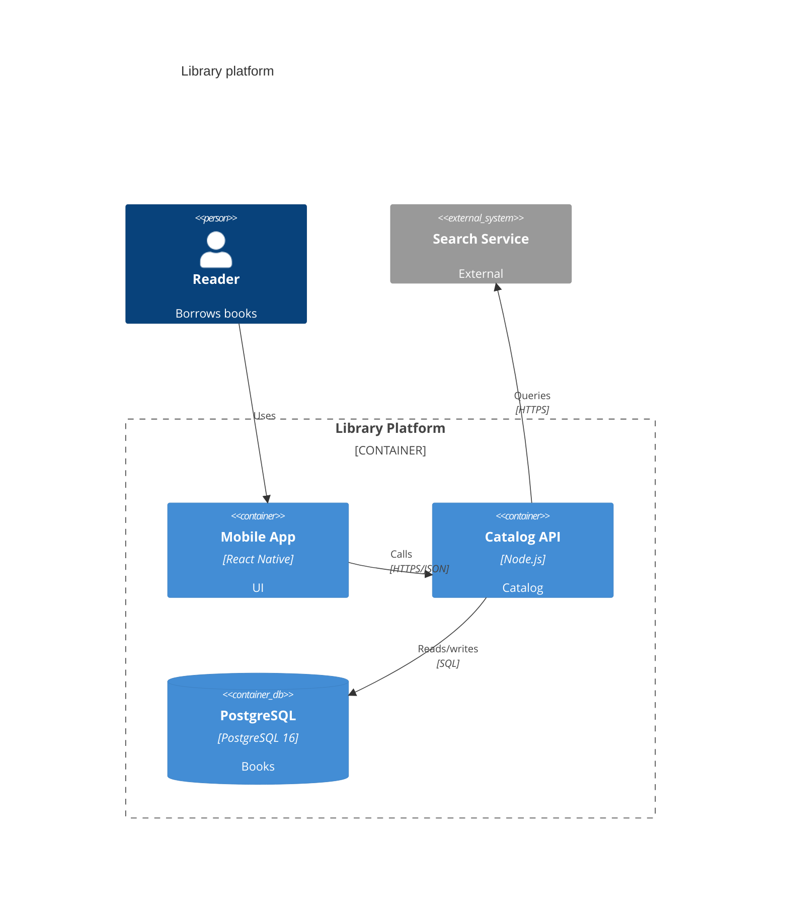

# C4 Diagrams

Only the Mermaid-specific facts; the C4 model itself is assumed known. Mermaid marks C4 support as experimental, so syntax and layout can change between versions.

## Picking the keyword

- `C4Context` for people and whole systems, `C4Container` for the apps and stores inside one system (the default for "the architecture"), `C4Component` for the inside of one container, `C4Dynamic` for numbered interactions, `C4Deployment` for nodes. The keyword is the first line.
- Elements: `Person`, `System`, `SystemDb`, `SystemQueue`, `Container`, `ContainerDb`, `ContainerQueue`, `Component`, each with an `_Ext` variant for external ones. Boundaries: `Enterprise_Boundary`, `System_Boundary`, `Container_Boundary`, `Boundary`.
- Argument order: `Container(id, "Label", "Technology", "Description")`, `Rel(from, to, "Label", "Technology")`. `System` and `Person` take no technology: `System(id, "Label", "Description")`.

## Layout (no auto-layout)

- Elements are placed in declaration order, left to right, wrapping after `$c4ShapeInRow` shapes (default 4) and `$c4BoundaryInRow` boundaries (default 2). Change both with `UpdateLayoutConfig`, and reorder declarations to untangle lines.
- `Rel_U`, `Rel_D`, `Rel_L`, `Rel_R` only hint at the direction of one arrow; they do not move elements.
- Overlapping relationship labels are moved with `UpdateRelStyle(from, to, $offsetX="...", $offsetY="...")`; element colors with `UpdateElementStyle(id, $bgColor="...", $fontColor="...")`. Set both colors together.
