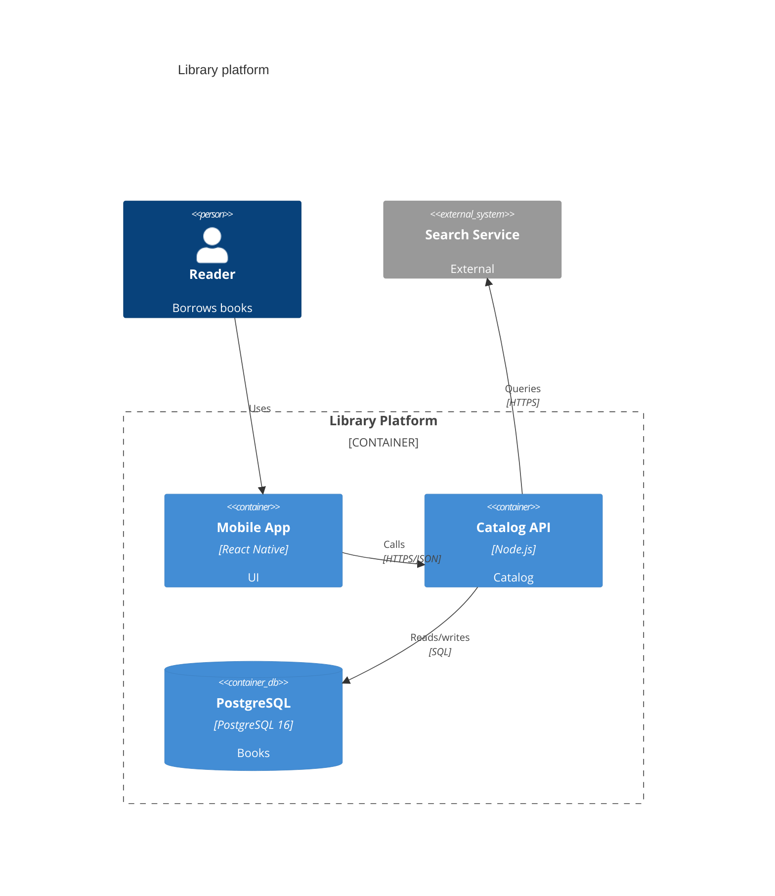
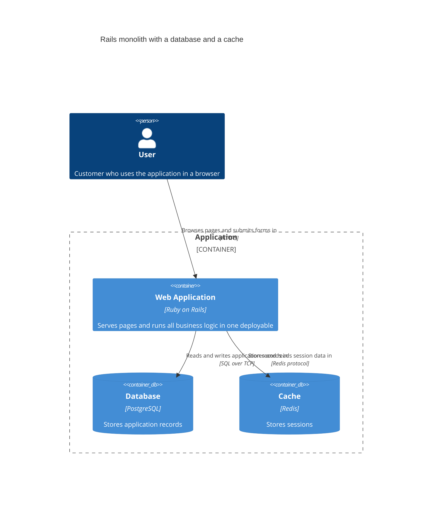
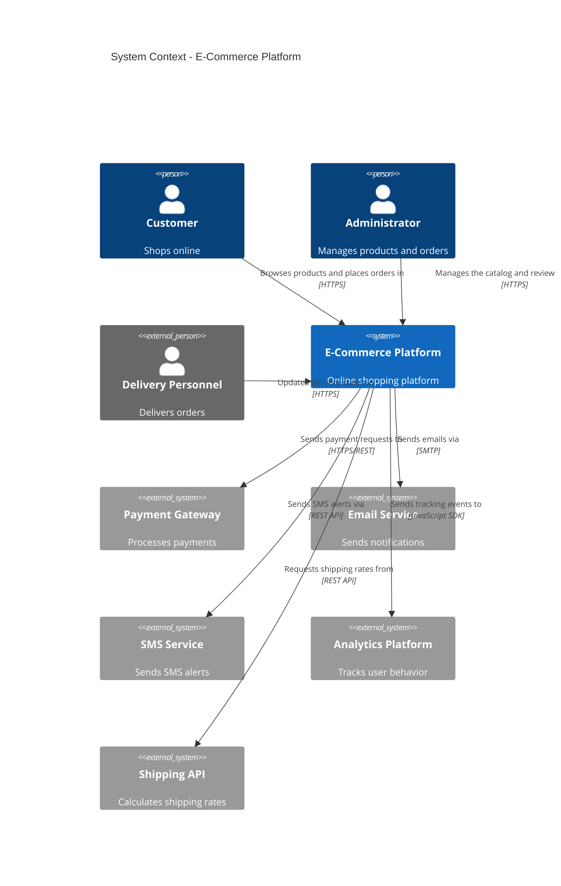
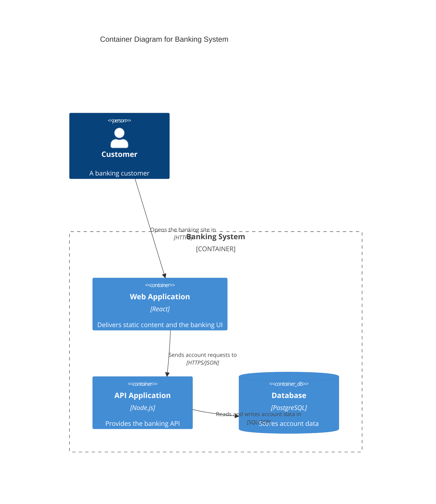
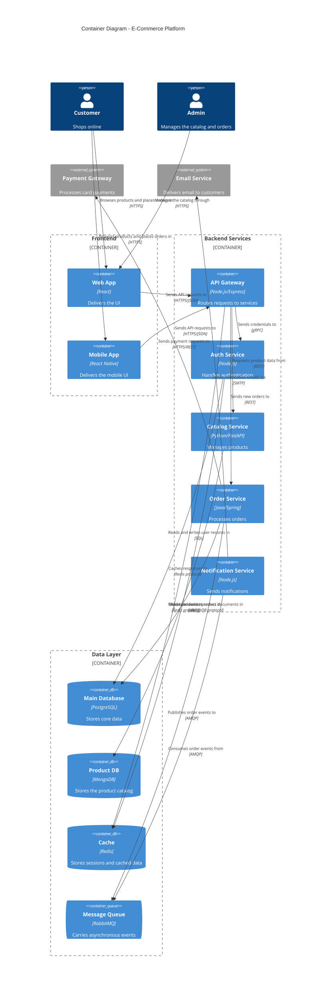
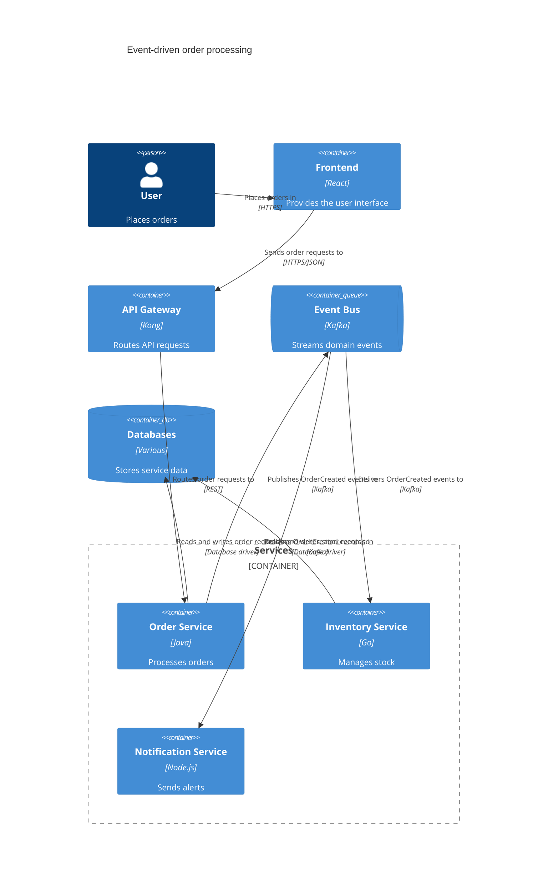
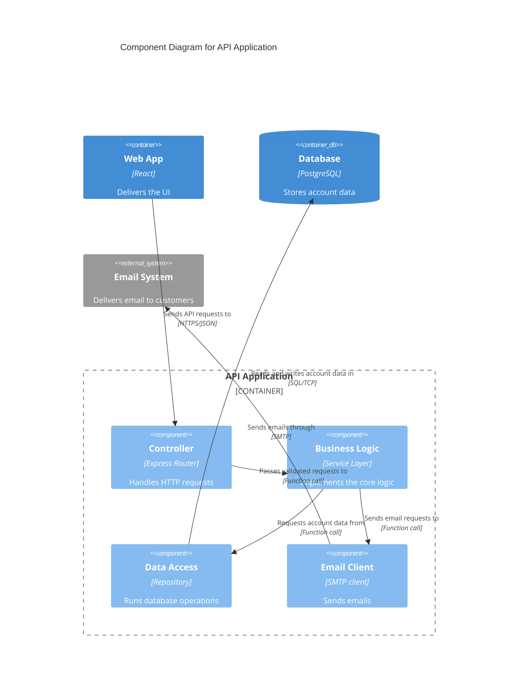
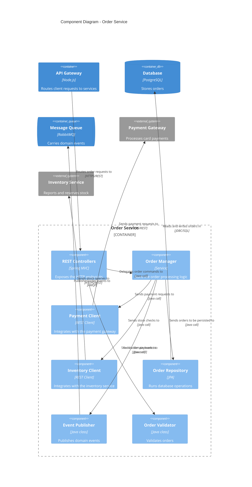

# C4 Diagrams

Only the Mermaid-specific facts; the C4 model itself is assumed known. Mermaid marks C4 support as experimental, so syntax and layout can change between versions.

## Picking the keyword

- `C4Context` for people and whole systems, `C4Container` for the apps and stores inside one system (the default for "the architecture"), `C4Component` for the inside of one container, `C4Dynamic` for numbered interactions, `C4Deployment` for nodes. The keyword is the first line.
- Elements: `Person`, `System`, `SystemDb`, `SystemQueue`, `Container`, `ContainerDb`, `ContainerQueue`, `Component`, each with an `_Ext` variant for external ones. Boundaries: `Enterprise_Boundary`, `System_Boundary`, `Container_Boundary`, `Boundary`.
- Argument order: `Container(id, "Label", "Technology", "Description")`, `Rel(from, to, "Label", "Technology")`. `System` and `Person` take no technology: `System(id, "Label", "Description")`.

## Example: monolith with a database and a cache

One deployable (here a Rails app) plus its stores is one `C4Container` diagram with a single boundary. Every element has a description and every `Rel` reads as a verb plus an object with the technology as the fourth argument; the ids `user`, `app`, `db` and `cache` are unique. Rendered with mmdc 12.2.0 (checked 2026-11-14):

## More examples by level

Each example follows the same rules as the monolith above: every element has a description, every `Rel` is a verb plus what is sent plus a technology, ids are unique, and elements take no `{ }` body (only boundaries do). Every block below rendered with mmdc 12.2.0 (checked 2026-11-14).

### Context: online shop with its external systems

Use when the question is who uses the system and which outside services it depends on. The old `SystemQueue_Ext` for the shipping API became `System_Ext`: an HTTP API is not a queue.

### Container: banking system with a React front end and a Node.js API

Use when the system is small (one web app, one API, one database) and a boundary around it is enough.

### Container: e-commerce platform with frontend, services and a data layer

Use when the system has several services and stores that read better in three layers (frontend, backend, data). Keep the three boundaries; without them the diagram becomes one unordered row.

### Container: event-driven services around a Kafka event bus

Use when services talk through events rather than direct calls: one `ContainerQueue` for the bus, one publisher and its consumers.

### Component: API application with controller, service, repository and email client

Use for the inside of one container when the layers are the point (controller calls service, service calls repository and an outbound client).

### Component: order service with clients, repository and event publisher

Use for a service with several outbound integrations (payment, inventory, a database and a queue) behind one manager component.

## Layout (no auto-layout)

- Elements are placed in declaration order, left to right, wrapping after `$c4ShapeInRow` shapes (default 4) and `$c4BoundaryInRow` boundaries (default 2). Change both with `UpdateLayoutConfig`, and reorder declarations to untangle lines.
- `Rel_U`, `Rel_D`, `Rel_L`, `Rel_R` only hint at the direction of one arrow; they do not move elements.
- Overlapping relationship labels are moved with `UpdateRelStyle(from, to, $offsetX="...", $offsetY="...")`; element colors with `UpdateElementStyle(id, $bgColor="...", $fontColor="...")`. Set both colors together.
