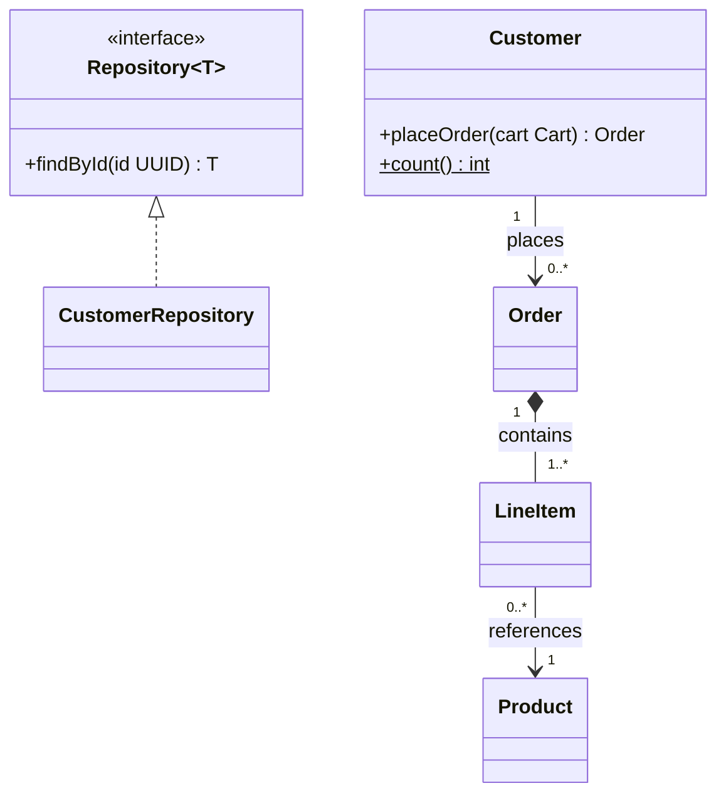

# Class Diagrams

Only the Mermaid-specific facts; UML semantics are assumed known.

## Arrow orientation

The arrowhead or diamond sits on the side it is written: `Parent <|-- Child`, `Interface <|.. Impl`, `Owner *-- Part`, `Whole o-- Member`.

## Generics

- Generics use tildes, not angle brackets: `Repository~T~`, `List~Order~`. Nested generics render in member types (`+List~List~int~~ items` shows `List<List<int>>`); as a class name (`class Box~List~int~~`) Mermaid 11.17 rejects them, so keep the class as `Box~T~` and put the nested type on its members. Use an alias only when validation on the target renderer fails.

## Traps

- Multiplicities must be quoted and sit next to their class (`Customer "1" --> "0..*" Order`); unquoted they are a parse error.
- Choose multiplicities from the domain, not from an example: a product can appear in many line items, so that end is `"0..*"`, not `"1"`.
- A class first referenced in a relationship is created empty; a later `class X { }` block with a different spelling creates a second class.
- Class names with spaces need backticks: ``class `Order Line` ``. Prefer CamelCase ids.
