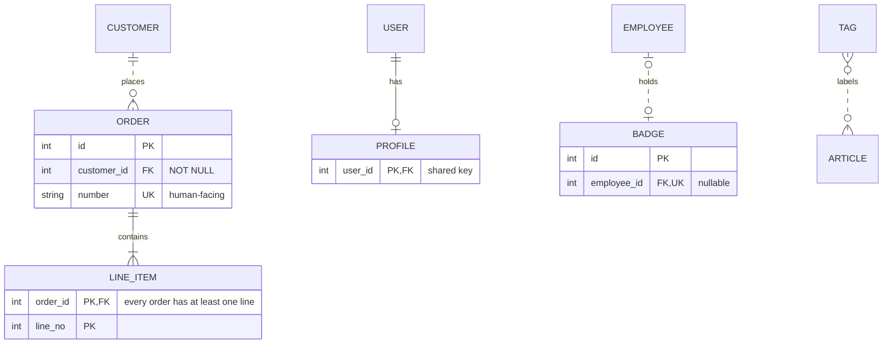

# Entity Relationship Diagrams

Only the facts that cause wrong or unrenderable ERDs. Basic `erDiagram` syntax is assumed known.

## Schema to diagram

1. List entities (tables). Name each one singular UPPER_SNAKE (`CUSTOMER`, `LINE_ITEM`), so relationship labels read as sentences (`CUSTOMER places ORDER`). When the user supplies a schema with plural table names (`line_items`), still use the singular entity and keep the real table name in the reply if it matters. Mermaid is case-sensitive about names.
2. For each foreign key, draw one relationship from the referenced (parent) table to the referencing (child) table.
3. Parent endpoint: it is `||` (exactly one) if the FK column is NOT NULL, `|o` (zero or one) if nullable.
4. Child endpoint: `o{` (zero or many) by default; `|{` (one or many) only if the schema or business rule forces at least one child; `o|` / `||` if the FK column is UNIQUE (or is the whole PK of the child).
5. Line, chosen per relationship: `--` identifying when that FK is part of the child's PK (weak entity, junction table with a composite key), `..` non-identifying otherwise, including a junction table with its own surrogate `id`.
6. Mark PK, FK, UK on columns. A composite PK is several `PK` rows.
7. Anything the schema does not settle (minimum child count, optional parent) is an assumption: choose the weaker option (`o{`, `|o`), and say so in the reply. Never copy cardinalities from an example.

## Cardinality symbols differ per endpoint

Read each side from the entity it touches. The left and right glyphs are mirror images:

| Meaning | Left endpoint | Right endpoint |
|---|---|---|
| Exactly one | `\|\|` | `\|\|` |
| Zero or one | `\|o` | `o\|` |
| One or many | `}\|` | `\|{` |
| Zero or many | `}o` | `o{` |

`}{` is not valid. Relationship form: `LEFT <left-glyph><line><right-glyph> RIGHT : "label"`; the label is mandatory (quote it if it has spaces).

Each line follows the steps above: ORDER and BADGE have their own `id`, so their lines are `..`; LINE_ITEM and PROFILE carry the FK in their PK, so theirs are `--`. `|{` on LINE_ITEM comes from the stated business rule, `o|` on PROFILE because the schema does not force a profile, `|o` on EMPLOYEE because `employee_id` is nullable. TAG to ARTICLE is the conceptual many-to-many form.

## Traps

- Many-to-many: a conceptual ERD may draw it directly (`TAG }o..o{ ARTICLE`). When the schema has an actual junction table, draw that table as an entity with one relationship to each side, choosing each line and endpoint independently by the rules above.
- Attribute order is `type name [PK|FK|UK] ["comment"]`. A type with spaces breaks the parser. A type with parentheses such as `decimal(10,2)` parses in Mermaid 11.17; if the target renderer rejects it, write `decimal` and move the precision into the comment.
- Entity names with spaces need quotes; attribute names cannot contain spaces.
- ERDs show structure, not behavior: soft-delete columns, audit trails and polymorphic references are plain columns here; do not invent relationships for them.
