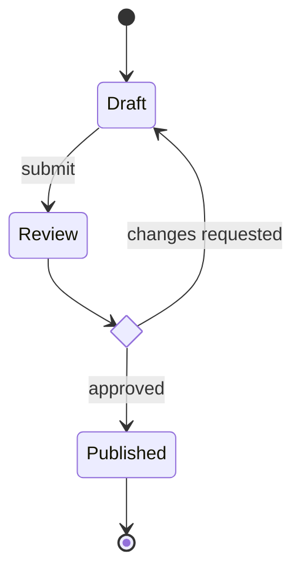
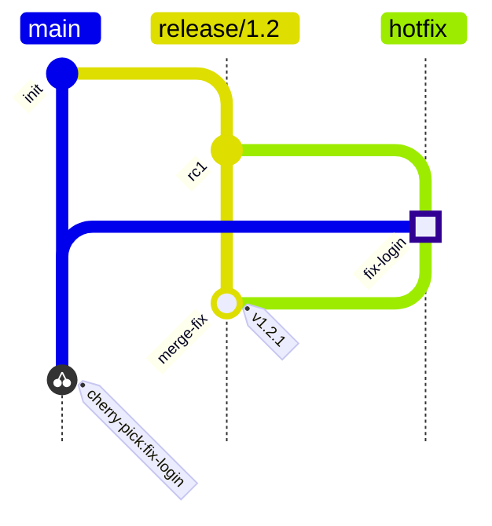
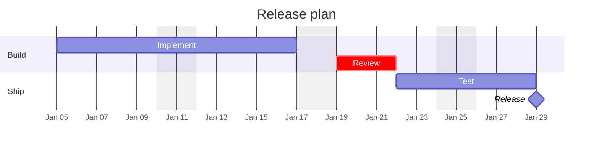

# State, Git, Gantt, and Pie

One working example per type (none for pie) plus the constructs that fail. Styling levers per type are in [authoring-rules.md](authoring-rules.md) section 3 ("Type-native controls").

## State (`stateDiagram-v2`)

- `<<choice>>` for a branch, `<<fork>>` and `<<join>>` for parallel paths, `state Name { ... }` for a composite state, `--` inside it for concurrent regions.
- `classDef` on `[*]` is a parse error. Every non-final state needs an outgoing transition, or the reader cannot tell a dead end from an omission.

## Git (`gitGraph`)

- `branch X` creates and switches to `X` (see the SKILL.md gotcha on `checkout`). The first branch is `main` unless `mainBranchName` is configured.
- `cherry-pick id: "..."` needs an `id:` set on that commit and fails if the commit is already on the current branch. Set an explicit `id:` on every commit you will merge, cherry-pick, or mention.
- `merge` takes the branch name; `id:`, `tag:`, and `type:` on a merge label the merge commit.

## Gantt (`gantt`)

- Task line: `Name :[tags,] [id,] start, end-or-duration`. `start` is a date or `after id1 id2` (starts when the last listed task ends); with no start, a task follows the previous one.
- Every literal date must match `dateFormat` exactly (dayjs tokens: `YYYY-MM-DD`, `DD/MM/YYYY`, `YYYY-MM-DD HH:mm`). Convert "Jan 5" to the declared format.
- `axisFormat` uses d3 strftime tokens (`%Y-%m-%d`, `%b %d`), a different token set from `dateFormat`.
- A milestone is `:milestone, id, date-or-after, 0d`. `excludes weekends` stretches durations over weekends.

## Pie (`pie`)

Syntax: `pie showData`, an optional `title`, then `"Label" : value` lines. Quote every label (the documented form; Mermaid 11.17 also accepts unquoted labels, older hosts may not). A negative value is a parse error. Beyond about seven slices, or for values that are not parts of one whole, use a bar chart in a chart tool instead.
