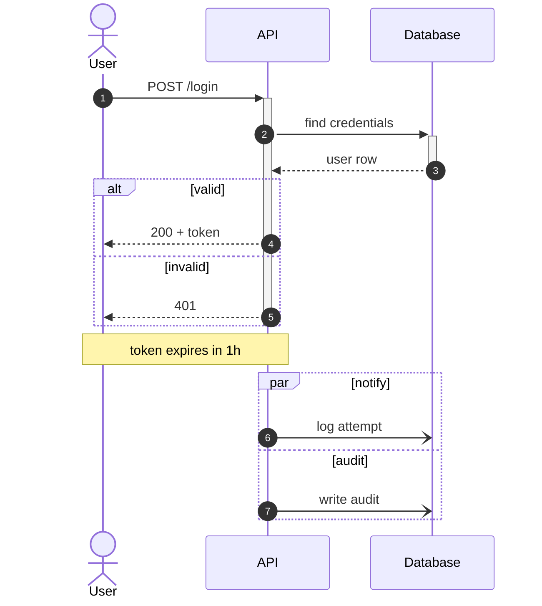

# Sequence Diagrams

Only non-obvious facts. `#`, `;`, and lowercase `end` traps are in [authoring-rules.md](authoring-rules.md) section 7 ("Labels that break the parser").

## Arrows

Beyond `->>` and `-->>`: `-)` / `--)` is async fire-and-forget (open arrowhead), and `-x` / `--x` marks a lost or failed message.

## Blocks

`alt/else`, `opt`, `loop`, `par/and`, `critical/option`, `break`, `rect rgb(...)`, `box`: each closes with its own `end`. One missing `end` shifts every later message into the wrong block before the parser fails at the bottom, so the reported line is not where the error is.

## Silent failures

- `+`/`-` activation shorthand must balance per participant: every `->>+` needs a later `-->>-` from the activated participant, or the bar runs to the bottom; an extra `-` is an error.
- A participant alias is `participant ID as Label`; later lines use the ID. Writing the label creates a second participant with no error.
- `autonumber` numbers only the messages after it; put it on the line after `sequenceDiagram`.
- Undeclared participants appear in first-use order; declare them all at the top to control left-to-right order.
