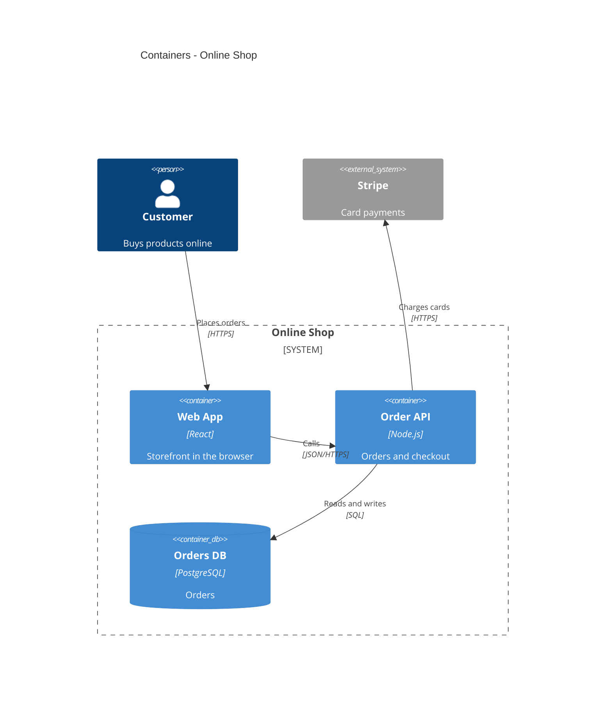

# C4 Architecture Skill

Generate software architecture documentation as C4 model diagrams in Mermaid syntax: context, container, component, dynamic and deployment views, built from a description or from repository evidence (docker-compose, Kubernetes manifests, package files).

## When to Use

- Document or map a software system, its deployable applications, data stores and external actors
- Produce views for a given audience (executives, product, architects, developers, DevOps)
- Show one request or event flow as a numbered dynamic view
- Show production infrastructure as a deployment view
- Translate a C4 diagram for a renderer without C4 support

**Trigger phrases**: "architecture diagram", "C4 diagram", "system context", "container diagram", "component diagram", "deployment diagram", "document architecture", "visualize architecture"

Not for ER diagrams, plain flowcharts or sequence diagrams, draw.io or cloud-icon diagrams, or ADR prose.

## Installation

**Claude Code:**

```bash
cp -r skills/c4-architecture ~/.claude/skills/
```

**claude.ai:** add the skill to project knowledge, or paste the contents of `SKILL.md` into the conversation.

Rendering checks use mermaid-cli (`mmdc`) when it is installed, or `npx -y -p @mermaid-js/mermaid-cli@11.17.0 mmdc` with network access.

## What It Does

`SKILL.md` holds the workflow: pick views for the audience, map repository evidence to C4 elements, draw boundaries, write to `docs/architecture/`, then render and check in a loop. It also holds the NEVER list of Mermaid C4 traps, such as hand-numbered dynamic labels and `Container` bodies.

## Example

**Request**: "Create C4 context and container diagrams for our shop: a React web app calls a Node.js order API, which stores orders in PostgreSQL and charges cards through Stripe."

**Output**: `docs/architecture/c4-context.md` and `docs/architecture/c4-containers.md`, each with a titled Mermaid diagram and an evidence table that marks every element as observed or inferred.



## References

- `references/c4-syntax.md`: Mermaid C4 macros, styling, layout, unsupported features, one rendered example per diagram type
- `references/advanced-patterns.md`: team ownership, event-driven flows, failure paths, deployment views, system landscape
- `references/common-mistakes.md`: wrong and correct versions of each modeling mistake

## Additional Resources

- [C4 Model](https://c4model.com/) - Official C4 model documentation
- [Mermaid C4 Diagrams](https://mermaid.js.org/syntax/c4.html) - Mermaid C4 syntax documentation
