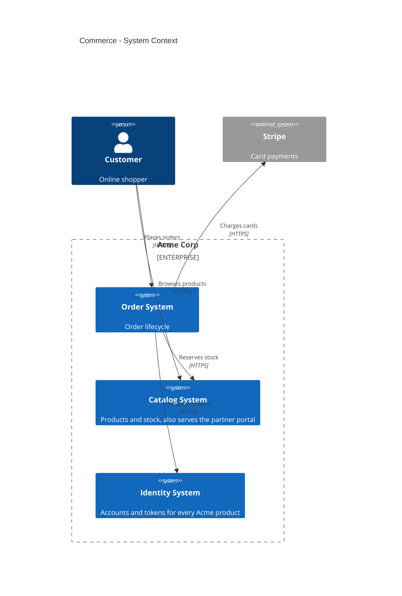
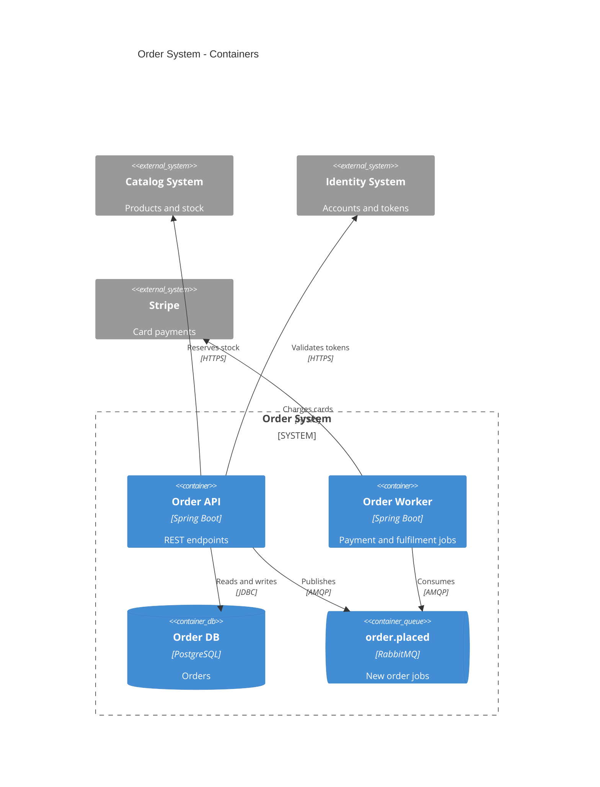
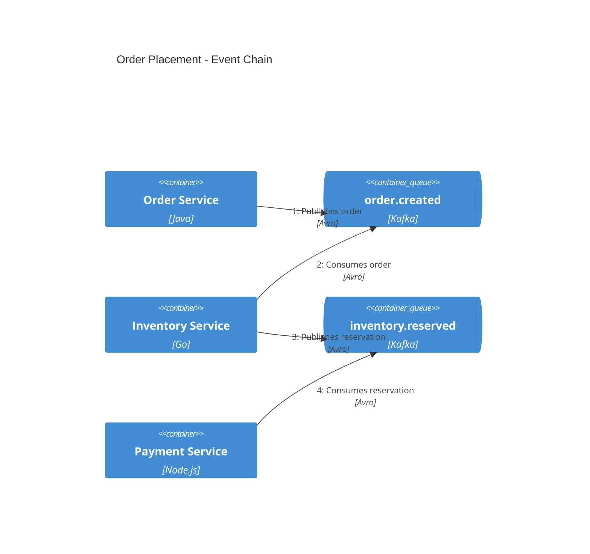
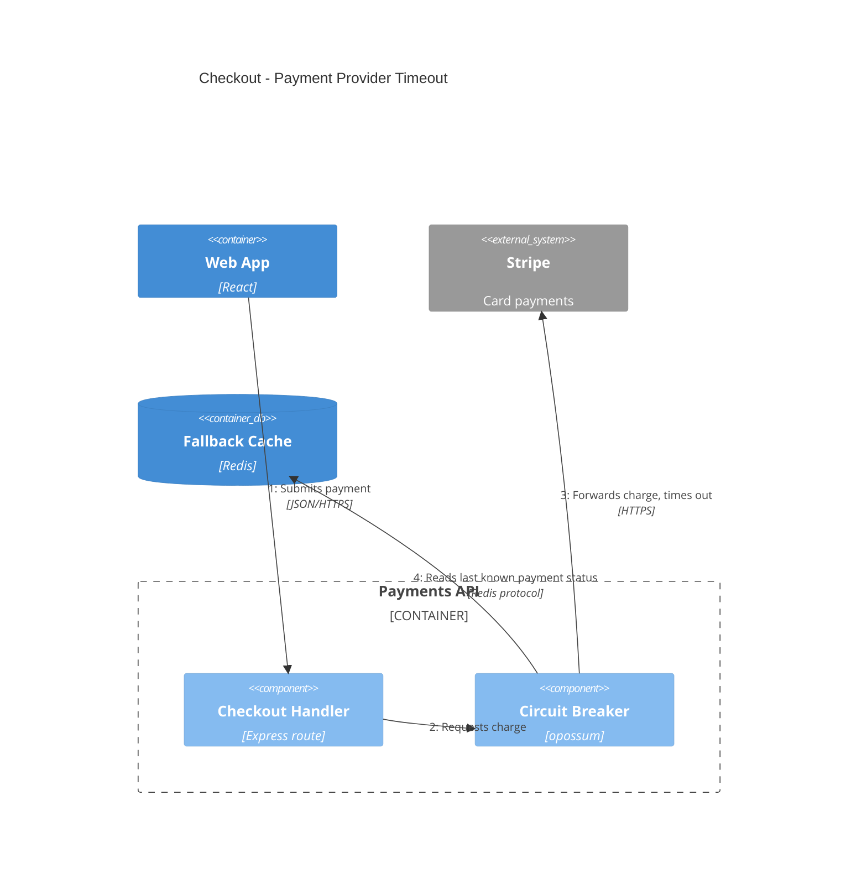
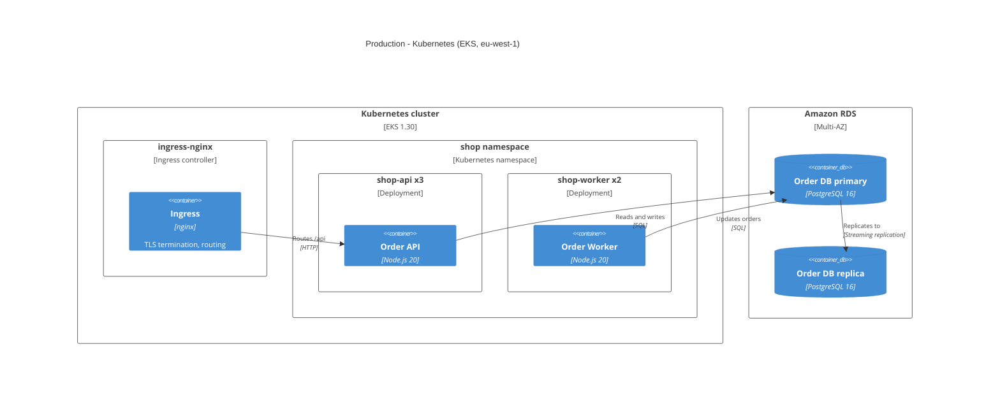
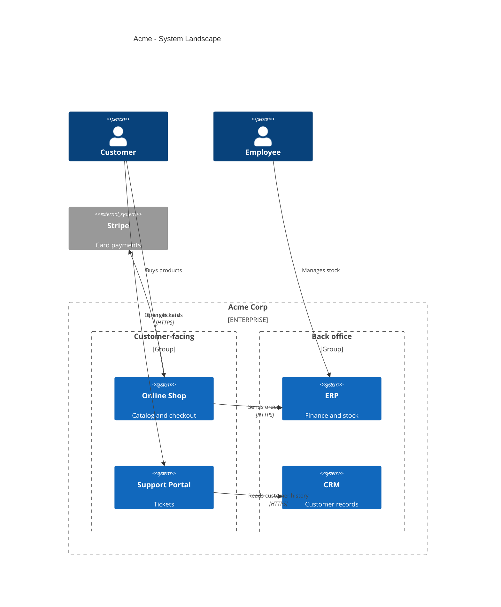

# Advanced C4 Patterns

Layouts for several software systems, event-driven flows and deployment views, with one rendered example each. The modeling rules and the NEVER list live in SKILL.md; the wrong-versus-correct examples live in common-mistakes.md.

## Several software systems

SKILL.md step 3 decides where system boundaries go; ownership alone never does. In this example Catalog and Identity are separate systems because each has consumers beyond the order flow and its own API and release cycle; the Order API and Order Worker stay containers of one Order System even if two teams own them.

Draw the context view first, then one container view per system:

In one system's container view, the other internal systems use `System_Ext`: outside this diagram's scope, not outside the company. Keep the same alias (`catalog`, `identity`) as in the context view.

## Event-driven flows

The container view shows which service publishes and consumes each topic (see common-mistakes.md for the single-broker mistake). A dynamic view shows one event chain in order. Mermaid numbers the relationships itself, so write them in sequence without numbers:

## Failure paths

The numbering is linear, so a success path and a failure path cannot share one dynamic diagram. Draw the failure path on its own, with the internal components inside a `Container_Boundary`:

## Deployment views

A deployment view places container instances on infrastructure. Replicas go in the node label (SKILL.md step 2), as the official Mermaid example does (`bigbank-api x8`). Draw separate instances only when they differ in role, such as a database primary and replica. Name the environment in the title.

## System landscape

Mermaid has no landscape diagram type. Draw an enterprise-wide view as a `C4Context` with an `Enterprise_Boundary`, grouping systems with `Boundary` when the groups carry meaning:

## Linking decisions

Diagrams show the chosen architecture; the reasons belong in ADRs. Reference an ADR in a `%%` comment or in the element description (`"Kafka, see ADR-003"`), never as "option A versus option B" boxes in the diagram.
