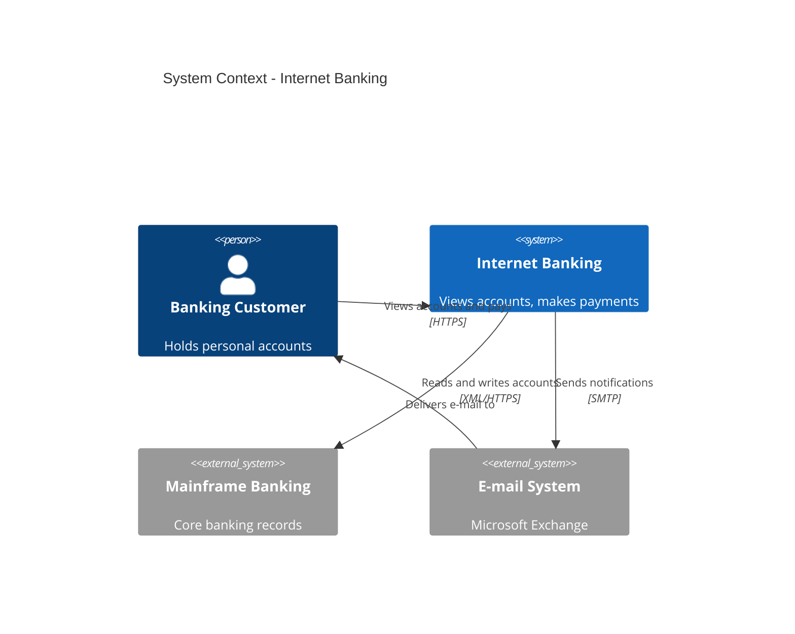
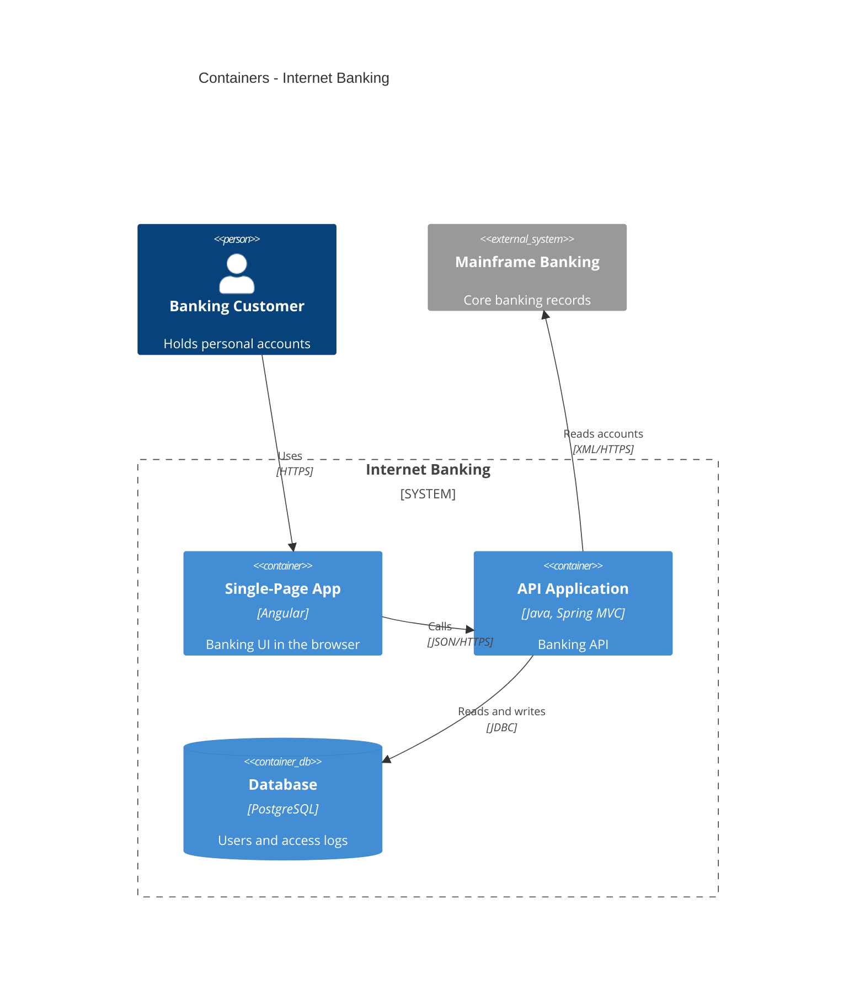
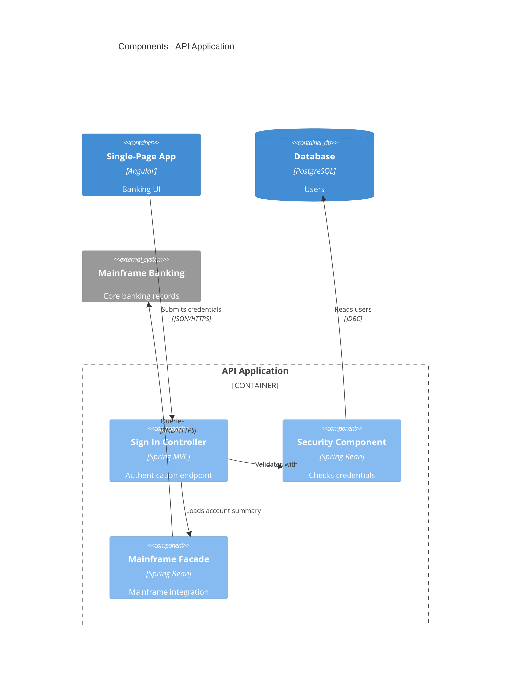
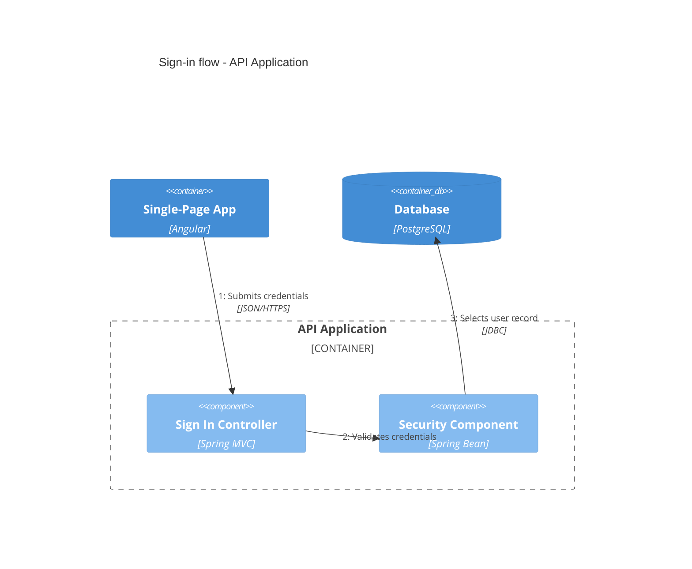
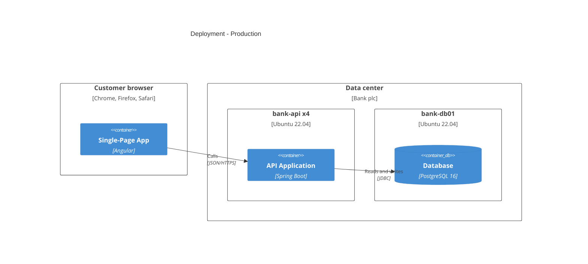

# Mermaid C4 Syntax Reference

Checked against the Mermaid C4 documentation (https://mermaid.js.org/syntax/c4.html) and rendered with mermaid-cli 11.17. Mermaid follows C4-PlantUML macro names, but supports only a subset. `?` marks an optional parameter.

## Contents

1. [Diagram types](#diagram-types)
2. [Elements](#elements)
3. [Boundaries and deployment nodes](#boundaries-and-deployment-nodes)
4. [Relationships](#relationships)
5. [Styling and layout](#styling-and-layout)
6. [Not supported](#not-supported)
7. [One example per diagram type](#one-example-per-diagram-type)

## Diagram types

Exactly five headers exist: `C4Context`, `C4Container`, `C4Component`, `C4Dynamic`, `C4Deployment`. Any other header (`C4Landscape`, `C4Code`) fails with `No diagram type detected`.

## Elements

```
Person(alias, label, ?descr)             Person_Ext(...)
System(alias, label, ?descr)             System_Ext / SystemDb / SystemDb_Ext / SystemQueue / SystemQueue_Ext
Container(alias, label, ?techn, ?descr)  Container_Ext / ContainerDb / ContainerDb_Ext / ContainerQueue / ContainerQueue_Ext
Component(alias, label, ?techn, ?descr)  Component_Ext / ComponentDb / ComponentDb_Ext / ComponentQueue / ComponentQueue_Ext
```

Elements take no `{...}` body. Every alias used in a relationship must be declared, or the whole diagram fails ("references an unknown shape").

## Boundaries and deployment nodes

These are the only constructs that take a `{...}` body:

```
Enterprise_Boundary(alias, label) { ... }
System_Boundary(alias, label) { ... }
Container_Boundary(alias, label) { ... }
Boundary(alias, label, ?type) { ... }
Deployment_Node(alias, label, ?type, ?descr) { ... }
Node(...) { ... }      short form of Deployment_Node
Node_L(...) { ... }    left-aligned node
Node_R(...) { ... }    right-aligned node
```

Boundaries and deployment nodes nest; the official deployment example nests three levels deep.

## Relationships

```
Rel(from, to, label, ?techn, ?descr)
Rel_U / Rel_Up, Rel_D / Rel_Down, Rel_L / Rel_Left, Rel_R / Rel_Right   placement hints
Rel_Back(from, to, label, ?techn)                                       arrow drawn from `to` back to `from`
BiRel(from, to, label, ?techn)                                          supported, but see the SKILL.md NEVER list
RelIndex(index, from, to, label)                                        index ignored
```

In `C4Dynamic`, Mermaid prefixes each relationship label with its position in statement order ("1: Submits credentials"). `RelIndex` and hand-written numbers do not change that order.

## Styling and layout

Parameters are positional or named with a `$` prefix in any order:

```
UpdateRelStyle(customer, api, "red", "blue", "-40", "60")
UpdateRelStyle(customer, api, $offsetY="60", $lineColor="blue")
```

- `UpdateElementStyle(alias, $bgColor, $fontColor, $borderColor, $shadowing, $shape)` restyles one element.
- `UpdateRelStyle(from, to, $textColor, $lineColor, $offsetX, $offsetY)`: the offsets move an overlapping relationship label, in pixels. Works in every diagram type, including `C4Dynamic`.
- `UpdateLayoutConfig($c4ShapeInRow="3", $c4BoundaryInRow="1")` changes shapes per row (default 4) and boundaries per row (default 2).
- There is no automatic layout: shapes appear in the order their statements are written. Reorder statements to move shapes.
- Put style and layout statements after the elements and relationships.
- Since Mermaid 11.17.1 element text wraps by default; set `c4: { wrap: false }` in the diagram config to turn it off.

## Not supported

Mermaid C4 has no `Legend`, `sprite`, tags (`AddElementTag`, `AddRelTag`), `$link`, custom shapes (`RoundedBoxShape`, `EightSidedShape`) or line styles (`DashedLine`, `DottedLine`, `BoldLine`), and there is no plan to support the layout statements `Lay_U`, `Lay_D`, `Lay_L` and `Lay_R`. When styling carries meaning, explain it in prose under the diagram. C4-PlantUML and Structurizr DSL support these features if the user needs them.

## One example per diagram type

All five render with mermaid-cli 11.17.










