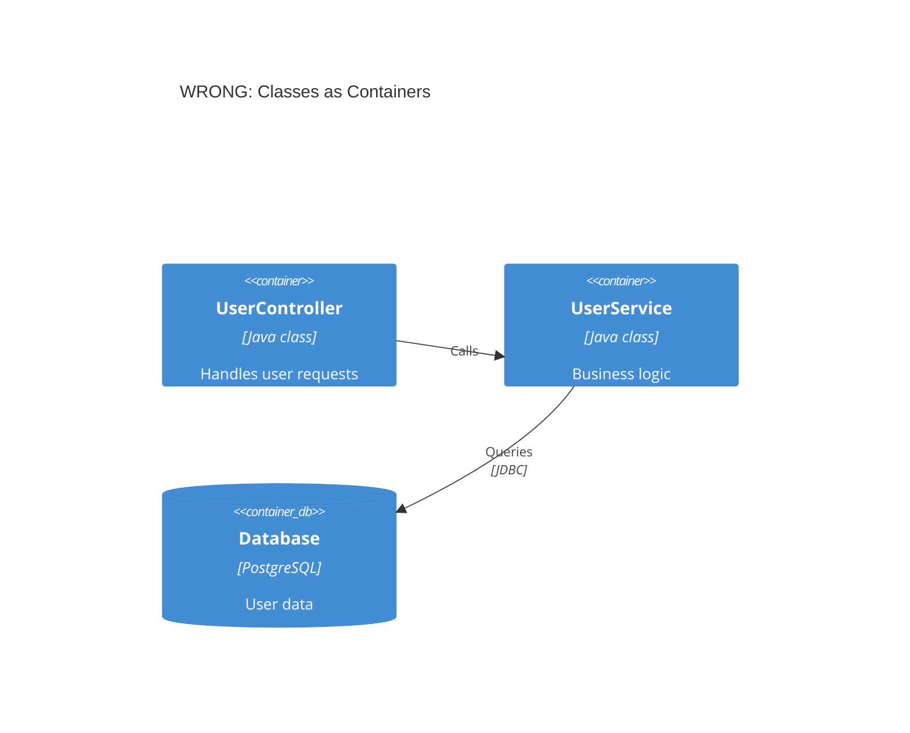
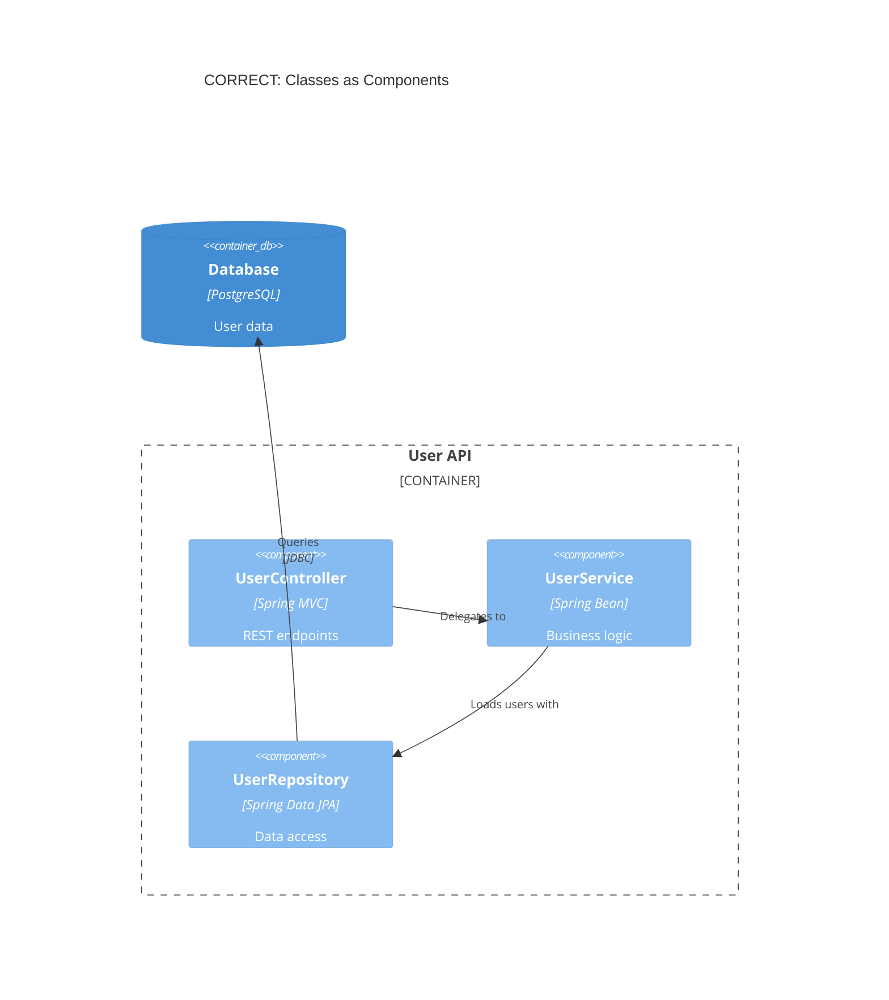
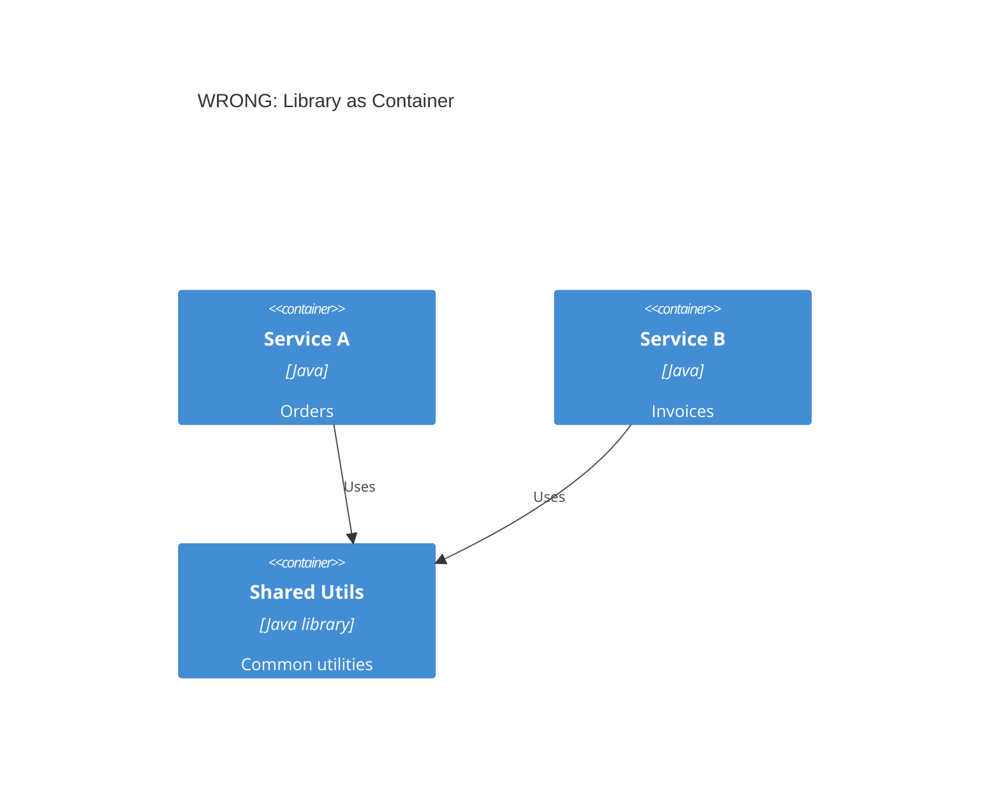
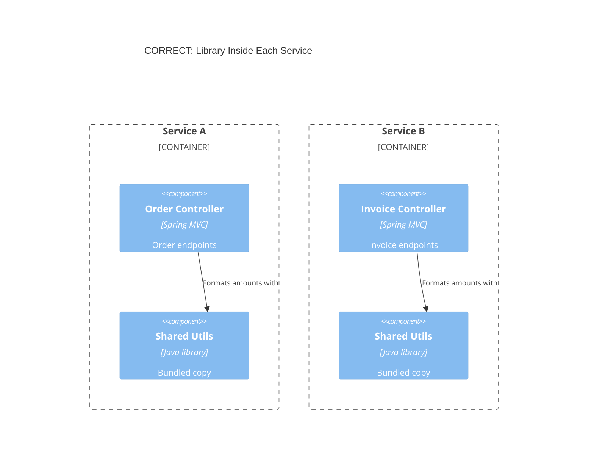
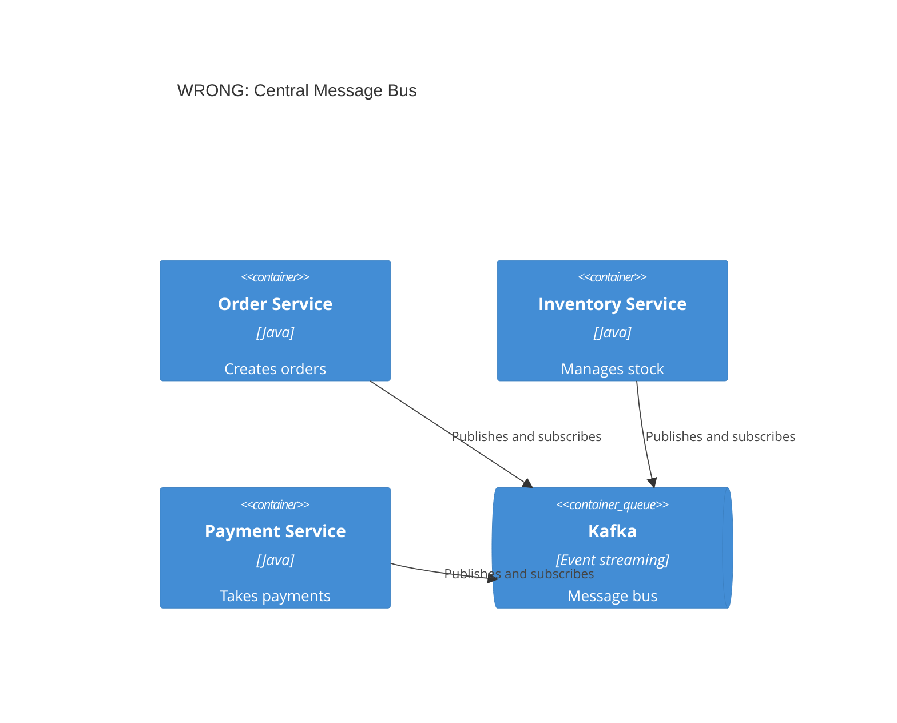
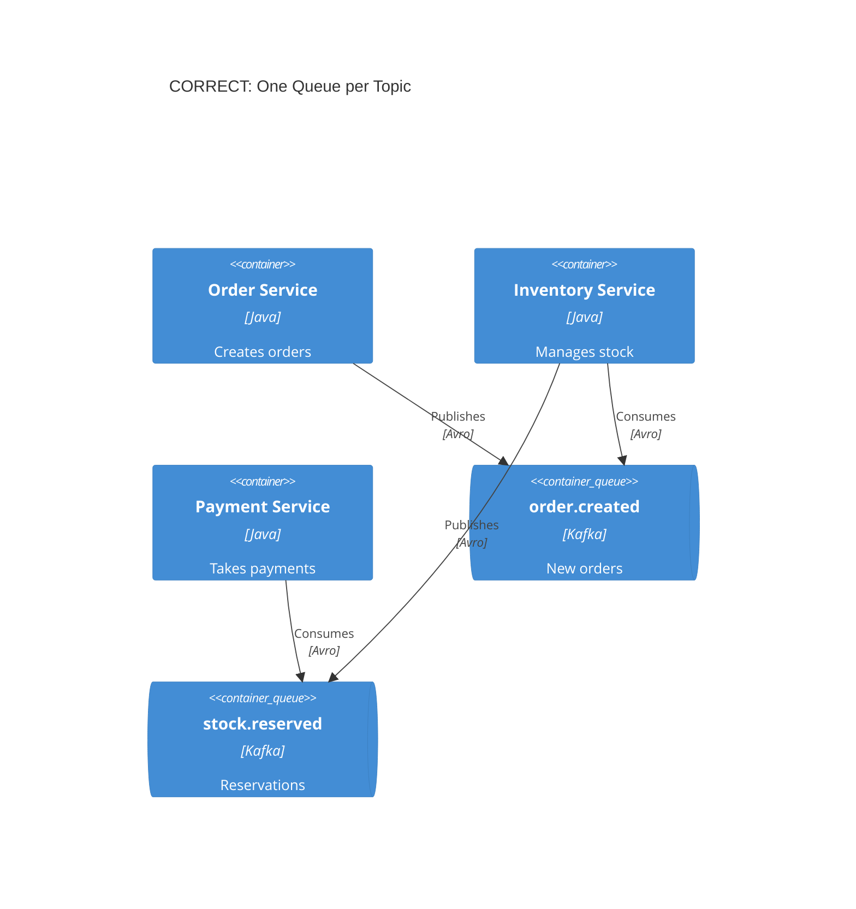
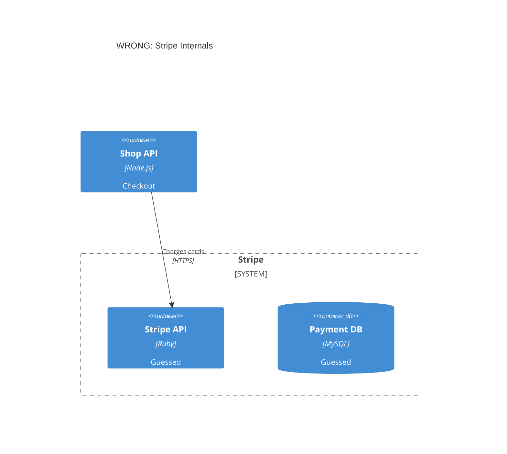
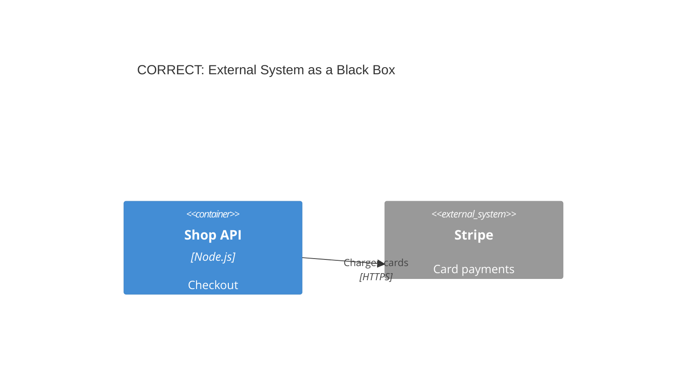
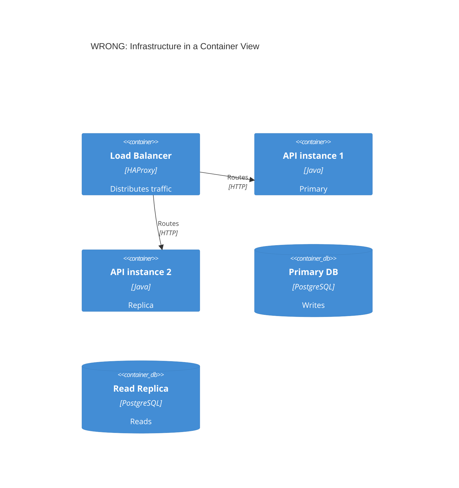

# Common C4 Mistakes: Wrong and Correct

Read the section for the model check that failed in SKILL.md step 5. The rules and their reasons live in SKILL.md; this file shows how to restructure the diagram.

## Classes or modules drawn as containers

A container is deployable; a class, module or framework inside one is a component.





Never invent in-between levels ("subsystem", "module group", "Level 2.5"): name each box a System, a Container or a Component.

## Shared library drawn as a container



Omit the library from container views. Show it only in a component view, as a bundled copy inside each consumer:



## One broker box for every message





With many topics, drop the queue boxes and draw each event delivery as one arrow from producer to consumer, with a verb and the topic in the label. Say under the diagram that the arrows are event deliveries through the broker, not direct calls:


## Internals of an external system



You do not control or observe those internals, so they are guesses that go stale.



## Two-way or unlabeled arrows

```
BiRel(frontend, api, "Data")          WRONG: who calls whom, and what flows?
Rel(orderSvc, paymentSvc)             WRONG: no verb, no technology
Rel(frontend, api, "Fetches products, submits orders", "JSON/HTTPS")   CORRECT
Rel(orderSvc, paymentSvc, "Requests payment authorization", "gRPC")   CORRECT
```

## Infrastructure in a container view



The container view keeps one `Container(api)` and one `ContainerDb(db)`. Instances, the load balancer and the replica move to a deployment view (see advanced-patterns.md), with the replica count in the node label.

## Too many elements

"If a diagram with a dozen boxes is hard to understand, don't draw a diagram with a dozen boxes!" (Simon Brown). When a view exceeds the SKILL.md budget, split it by bounded context, or draw one service with its direct dependencies per diagram.

## Inconsistent names across views

"Payment System" in the context view, "Payment Service" in the container view and "Payment Module" in the component view read as three different things. Reuse one name and one alias per element in every view.

## Colors without a key

Mermaid C4 renders no legend (see c4-syntax.md, Not supported). If `UpdateElementStyle` colors carry meaning, explain them in a line of prose under the diagram.

## Deployment view without an environment

`title Deployment Diagram` leaves the reader guessing. Name it: `title Deployment - Production (AWS eu-west-1)`.
