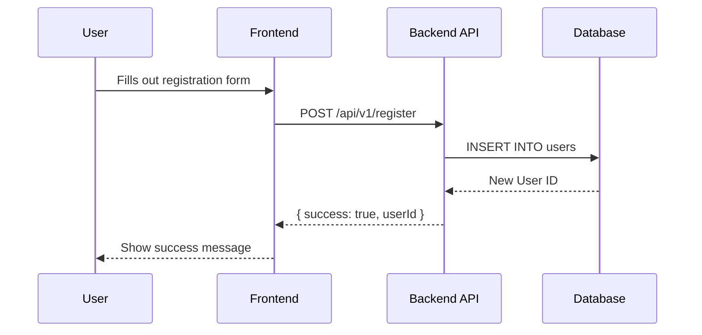

# PR body reference

Loaded on demand by the `explain-pr-changes` command. The command keeps the mode routing, invariants and phases; this file holds only the none-mode filter implementation, the title and body assembly code, and the body templates.

## None-mode diagram filter

````bash
awk '
{
  if (match($0, /^ ? ? ?(```+|~~~+)/)) {
    m = substr($0, 1, RLENGTH); rest = substr($0, RLENGTH + 1); sub(/^ +/, "", m)
    c = substr(m, 1, 1); n = length(m)
    if (!open) { open = 1; oc = c; on = n; if (rest ~ /^[ \t]*mermaid([ \t]|$)/) skip = 1; if (!skip) print; next }
    if (c == oc && n >= on && rest ~ /^[ \t]*$/) { open = 0; if (skip) { skip = 0; next } }
  }
  if (!skip) print
}
END { if (skip) exit 1 }' "$AD/body.md" > "$AD/body.stripped.md" \
  && sed -E 's#!\[[^]]*\]\([^)]*github\.com/user-attachments/[^)]*\)##g' "$AD/body.stripped.md" > "$AD/body.inline.md" \
  && awk '
function norm(s) { s = tolower(s); gsub(/[ \t]+/, " ", s); sub(/^ /, "", s); sub(/ $/, "", s); return s }
NR == FNR {
  if (match($0, /^ ? ? ?\[[^]]+\]:[ \t]*<?[^ \t>]*github\.com\/user-attachments\//)) {
    d = substr($0, 1, RLENGTH); sub(/^ */, "", d); sub(/^\[/, "", d); sub(/\]:.*$/, "", d); att[norm(d)] = 1
  }
  next
}
{
  out = ""; rest = $0
  while (match(rest, /!\[[^]]*\](\[[^]]*\])?/)) {
    t = substr(rest, RSTART, RLENGTH); lab = t; sub(/^!\[/, "", lab)
    if (lab ~ /\]\[/) { alt = lab; sub(/\]\[.*$/, "", alt); sub(/^.*\]\[/, "", lab); sub(/\]$/, "", lab); if (lab == "") lab = alt }
    else sub(/\]$/, "", lab)
    out = out substr(rest, 1, RSTART - 1)
    if (!(norm(lab) in att)) out = out t
    rest = substr(rest, RSTART + RLENGTH)
  }
  print out rest
}
' "$AD/body.inline.md" "$AD/body.inline.md" > "$AD/body.filtered.md" \
  && mv "$AD/body.filtered.md" "$AD/body.md"
````

The sed step removes inline images (``). The last awk step reads the file twice: the first pass collects the labels of reference definitions (`[label]: url`, case-insensitive, whitespace collapsed) whose URL contains `github.com/user-attachments/`; the second removes each image usage `![alt][label]`, `![alt][]` and `![label]` that resolves to such a label. Images that resolve to any other label, ordinary-host images and surrounding prose stay. The definition lines themselves stay: they render nothing, and a plain link `[text][label]` may still use them.

The awk step writes to its own file first so the `&&` chain sees awk's exit status. When a source body's mermaid fence is never closed, `skip` is still set at EOF: the awk step then exits non-zero and the command stops with the named error `unclosed mermaid fence in PR body` before any PR write, instead of silently dropping the rest of the body.

## Title normalization and body assembly

Loaded only for a single-source or consolidated body (2.1, 2.2). `$new_title` below is the shell variable of 2.4.

### Single-source title (2.1)

```bash
title=$(jq -r .title "$AD/source-<PR>.json")
if [[ $title =~ ^\[[^]]*\ →\ [^]]*\]\  ]]; then
  stripped=${title#"${BASH_REMATCH[0]}"}
else
  stripped=$title
fi
new_title="[$head → $base] $stripped"
```

### Title data handling (2.4)

Titles, bodies, authors, head and base names are data, never code. Extract each title with `title=$(jq -r .title "$AD/source-<n>.json")` straight from the saved JSON, apply the prefix rule above to that shell variable, expand it only as a quoted argument (for example `printf '%s\n' "# PR Summary: $new_title"`), write it to `$AD/title.txt`, and let every gh call read it from there. Never substitute PR-derived text into shell source or an unquoted heredoc: a title containing `$()`, backticks or `"` would otherwise execute or break the command.

In Bash, test with `[[ $title =~ ^\[[^]]*\ →\ [^]]*\]\  ]]`; when it matches, remove exactly `${BASH_REMATCH[0]}` with `stripped=${title#"${BASH_REMATCH[0]}"}`, otherwise leave the title unchanged. This bounded regex does not strip `[docs] Note → keep] Fix`.

### Single-source body (2.5)

```bash
if head -n 1 "$AD/source-<n>.md" | grep -q '^# PR Summary:'; then
  printf '%s\n' "# PR Summary: $new_title" > "$AD/body.md"
  tail -n +2 "$AD/source-<n>.md" >> "$AD/body.md"
else
  cat "$AD/source-<n>.md" > "$AD/body.md"
fi
printf '%s\n' "$new_title" > "$AD/title.txt"
```

(`$new_title` is the shell variable of 2.4: the source title extracted with jq, prefix-dropped and re-prefixed — never the title typed inline.)

### Consolidated body, per source (2.6)

```bash
title=$(jq -r .title "$AD/source-<n>.json")
printf '\n\n%s\n\n' "### [#<n> $title](https://github.com/$REPO/pull/<n>)" >> "$AD/body.md"
if head -n 1 "$AD/source-<n>.md" | grep -q '^# PR Summary:'; then
  tail -n +2 "$AD/source-<n>.md" >> "$AD/body.md"
else
  cat "$AD/source-<n>.md" >> "$AD/body.md"
fi
```

The `printf` writes two newlines before and after each heading outside the copied source bytes, guaranteeing a blank line before and after it even when the previous copied body has no trailing newline; a body saved without a trailing newline (2.1 uses `jq -j`) can never glue the next `###` heading onto its last line.

## Body templates

````markdown
# PR Summary: $title

## 📜 High-Level Summary

<!-- Insert the concise, high-level summary (max 150 words) from the summary rule here. -->

## 📊 Architectural Impact & Visualizations

<!--
  - Insert the diagram from the diagram rule here, if applicable.
  - mermaid: one fenced code block with the `mermaid` identifier.
  - drawio, rendered: the image reference whose path equals the --attach argument.
  - Precede the diagram with a brief explanation.
  - If no diagram is needed, this entire section can be omitted.
-->

**Example:**
This diagram illustrates the new data flow for user registration.



## ⚙️ Detailed Changeset Breakdown

---

### Changeset 1: [Meaningful Title for the First Group of Changes]

**Files Affected:**

- `path/to/file1.go`
- `path/to/another/file.go`

**Summary of Changes:**

- <!-- Bulleted list explaining the specific changes in this changeset. -->
- <!-- Remember to note any changes to public APIs, function signatures, or global state. -->

**[TRIAGE]:** <NEEDS_REVIEW or APPROVED>
````

A consolidated body uses the same summary heading and overview, then replaces the changeset breakdown with:

```markdown
## Included PRs

### [#<n> <title>](https://github.com/$REPO/pull/<n>)

<that source body verbatim, minus its own "# PR Summary:" heading line when the body starts with one>
```
